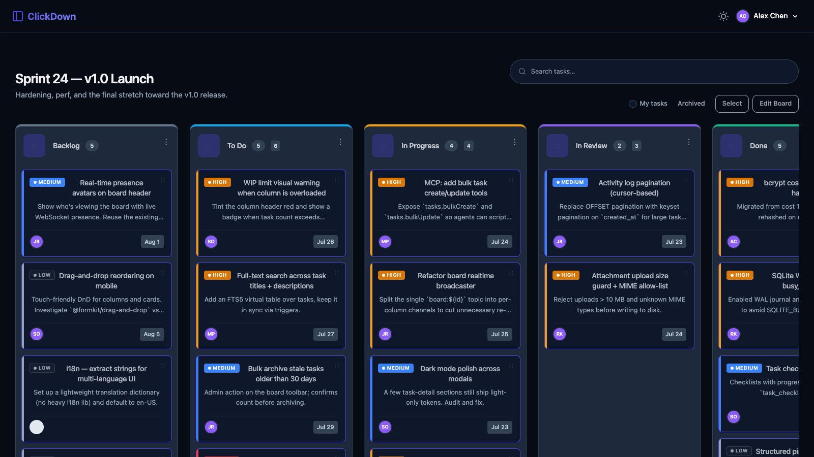

# ClickDown

<p align="center">
  
</p>

A fast, lightweight, multi-team **Kanban task manager** built on [Bun](https://bun.sh) and SQLite. ClickDown uses a hypermedia-driven architecture — server-side rendering with [HTMX](https://htmx.org/) and [Alpine.js](https://alpinejs.dev/) — to deliver a responsive, app-like experience without a heavy client-side framework or build step.

It is **local-first**: a single Bun process provides the database (embedded SQLite), file storage (`data/uploads/`), and real-time updates (in-process WebSockets). No CDN, cloud service, or external broker is required — the app runs fully offline or on a LAN.

## ✨ Features

**Tasks**
- Title, description (with **Markdown** rendering + Write/Preview toggle), priority (low / medium / high / urgent), assignee, and due date
- Inline editing of every field from a task detail modal
- **Checklists**, **comments**, **labels**, and **file attachments** (stored under `data/uploads/`)
- **Duplicate** a task, or **bulk-select** and delete many at once
- **Archive** tasks (soft-hide) with a recycle-bin style archive view; permanent purge (single task or empty archive)
- **Activity log** per task tracking who changed what
- **Shareable deep links** — every task has a `/tasks/:id` URL that opens its board with the task modal expanded
- Priority color-coding and overdue / due-soon badges
- Dashboard summary of assigned tasks with team/board context

**Boards**
- Boards created with a default Backlog → To Do → In Progress → Done flow
- Customizable columns (add, edit, delete, reorder, color, **WIP limits**) — **admin/owner only**
- Drag-and-drop tasks within a column, across columns; column reorder for admins
- **Live task search** across the board, "My tasks only" filter, and "Show archived"
- **Keyboard shortcuts** (`/` focuses search, `n` adds a task, `Esc` closes modals)

**Teams & collaboration**
- Create teams, or join via a **tokenized invite link** (slug alone is not enough; owners/admins can regenerate the link)
- Owner / admin / member roles, with a **member-management UI** to change roles and remove members
- Isolated boards and tasks per team with membership-based access control
- Board/column **structure** mutations require admin or owner; task work is open to all members

**Real-time (WebSocket)**
- **Live presence** — avatars appear/disappear as team members open or close the board; new viewers receive a roster of who's already there
- **Live task updates** — create, edit, move, delete, and archive operations broadcast to all viewers instantly
- **Refresh safety** — remote changes reload the board with your search/filters preserved, and are deferred (with a notice) while you have a dialog open so unsaved edits are never lost
- Built on Bun's native `server.publish()` + HTMX WS Extension + Alpine.js; no external message broker required

**Accounts & UX**
- Registration / login / logout with bcrypt-hashed passwords (cost 12) and strength validation (8+ chars with upper, lower, digit, and special character)
- Profile settings to update display name, email, and password (email or password change requires your current password; other sessions are revoked)
- **API tokens** for AI agents — create/revoke personal tokens from the profile page (see MCP below)
- Auto-generated initials avatars
- Light / dark theme toggle (persisted to `localStorage`)
- **Toast notifications** for all actions — visible even above open modals, and on network failures
- Responsive layout and a custom design system over a modernized Pico CSS base
- Structured logging via [pino](https://getpino.io/); health probes at `/health` and `/ready`

**AI agent API (MCP)**
- [Model Context Protocol](https://modelcontextprotocol.io) endpoint at `POST /api/mcp` (Streamable HTTP, JSON-RPC 2.0)
- Personal bearer tokens (SHA-256 hashed at rest) created from the profile page, with a one-step `claude mcp add` command shown on creation
- 16 tools covering teams, boards, tasks, checklists, comments, and search — mutations broadcast live to open boards

## 🛠 Tech Stack

| Layer | Technology |
| --- | --- |
| Runtime & server | [Bun](https://bun.sh) (`Bun.serve`) |
| Database | SQLite via `bun:sqlite` |
| Templating | [@kitajs/html](https://github.com/kitajs/html) (server-side JSX → HTML) |
| Interactivity | [HTMX](https://htmx.org/) + [Alpine.js](https://alpinejs.dev/) |
| Styling | [Pico CSS](https://picocss.com/) + a custom design system |
| Auth | `bcrypt` password hashing, cookie sessions, SHA-256-hashed API tokens |
| Agent API | [MCP](https://modelcontextprotocol.io) Streamable HTTP (JSON-RPC 2.0, no SDK dependency) |
| IDs | `nanoid` |
| Logging | [pino](https://getpino.io/) |
| Lint / Format | [Biome](https://biomejs.dev/) |
| Testing | `bun test` (unit + integration) + [Playwright](https://playwright.dev/) (E2E, Chromium + Firefox) |

## 🚀 Getting Started

### Prerequisites

[**Bun 1.3.14**](https://bun.sh) is the only requirement. Install or upgrade it if needed:

```bash
curl -fsSL https://bun.sh/install | bash
bun upgrade
```

If you use [mise](https://mise.jdx.dev/), the pinned `mise.toml` provides the same version automatically (`mise install`).

### Installation

```bash
git clone <repository-url>
cd ClickDown
bun install
```

### Database Setup

`bun run dev` and `bun run start` apply pending SQLite migrations automatically. You can also run them explicitly:

```bash
bun run db:migrate
```

By default the database lives at `data/clickdown.db` (override with `DB_PATH`).

### Running the App

```bash
bun run dev     # development, with hot reload (recommended)
bun run start   # production
```

The app is then available at **[http://localhost:3000](http://localhost:3000)**.

Health checks: `GET /health` (liveness) and `GET /ready` (schema and writable local upload storage).

All browser runtime assets are served locally from installed packages. Running ClickDown does not require CDN or cloud-service access.

### Docker

A production-ready `Dockerfile` is included:

```bash
docker build -t clickdown .
docker run -p 3000:3000 -v clickdown-data:/app/data -e NODE_ENV=production clickdown
```

The container:
- Applies pending migrations before accepting traffic, and ships a `HEALTHCHECK` on `/ready`
- Installs **production dependencies only** in the runtime stage (no Playwright/TypeScript/Biome)
- Runs as the non-root `bun` user with the base image pinned by digest
- Persists SQLite data (and uploads) in a named volume (`clickdown-data`)
- Sets `NODE_ENV=production` (strict CSRF Origin checks)
- Declares `STOPSIGNAL SIGTERM` — the app shuts down gracefully (stops accepting requests, closes WebSocket connections, closes the database)
- Exposes port 3000

The SQLite, in-memory rate limit, and WebSocket design supports **one application process**. Do not run multiple replicas against the same database volume.

`.dockerignore` excludes test files, local DBs, and dev tooling for a minimal image.

Optional smoke: `bun run smoke:docker` — builds the image, polls `/ready`, checks `/health`, and always cleans up (requires Docker).

## ⚙️ Configuration

ClickDown is configured through environment variables (Bun auto-loads `.env`):

| Variable | Default | Description |
| --- | --- | --- |
| `PORT` | `3000` | Port the HTTP server listens on |
| `DB_PATH` | `data/clickdown.db` | SQLite database file path |
| `NODE_ENV` | — | Set to `production` for CSRF Origin requirements and quieter logs |
| `APP_URL` | request origin | Browser-facing base URL used for invite links and Origin checks; set this behind a reverse proxy |
| `TRUST_PROXY` | `false` | Trust `X-Forwarded-For` for rate-limit keys; enable only behind a controlled proxy |
| `COOKIE_SECURE` | inferred from `APP_URL` | Force (`true`) or disable (`false`) the Secure cookie flag |
| `E2E_TEST` | — | Test-only flag that disables rate limiting; set automatically by Playwright, never in production |
| `UPLOAD_DIR` | `data/uploads` | Local directory for task attachments |
| `LOG_LEVEL` | `debug` / `info` | Pino log level (`debug` in dev, `info` in production by default) |

## 🤖 MCP (AI agent) endpoint

ClickDown exposes a [Model Context Protocol](https://modelcontextprotocol.io) endpoint so AI agents (Claude Code, Cursor, custom scripts, etc.) can find and work on tasks directly.

**Endpoint:** `POST /api/mcp` (Streamable HTTP transport, JSON-RPC 2.0)

### Setup

1. Open **Profile → API Tokens (MCP)** and create a token. It is shown once — copy it.
2. Register ClickDown with Claude Code (the profile page shows this command pre-filled with your token and URL):

   ```bash
   claude mcp add --transport http clickdown http://localhost:3000/api/mcp \
     --header "Authorization: Bearer cd_your_token_here"
   ```

3. In Claude Code, run `/mcp` to verify the connection.

For config-file based clients (Cursor, etc.):

```json
{
  "mcpServers": {
    "clickdown": {
      "type": "http",
      "url": "http://localhost:3000/api/mcp",
      "headers": { "Authorization": "Bearer cd_your_token_here" }
    }
  }
}
```

Tokens act **as your user** (full team access) and can be revoked at any time from the profile page. Only the SHA-256 hash is stored; session cookies are not accepted on the endpoint.

### Available tools

| Tool | Purpose |
| --- | --- |
| `list_teams` / `list_boards` / `get_board` | Navigate teams → boards → columns |
| `list_tasks` | Tasks on a board (filter by column, assignee, archived) |
| `get_task` | Full detail: description, checklist, comments, labels, attachments |
| `create_task` / `update_task` / `move_task` / `archive_task` / `delete_task` | Task lifecycle |
| `add_comment` | Leave progress notes on a task |
| `add_checklist_item` / `toggle_checklist_item` / `delete_checklist_item` | Checklist management |
| `search_tasks` | Text search across all accessible boards |
| `get_my_tasks` | Everything assigned to the token's user |

All mutations broadcast over the existing WebSocket layer, so open boards update live when an agent makes a change. A typical agent flow: `list_teams` → `list_boards` → `list_tasks` → `get_task` → `move_task` + `add_comment`.

## 📁 Project Structure

```
src/
├── index.tsx             # Entry point: handleRequest() + Bun.serve()
├── config/               # Database + migrations runner
├── middleware/           # Session auth
├── mcp/                  # MCP protocol (JSON-RPC) + agent tool definitions
├── models/               # TypeScript types
├── realtime/             # WebSocket pub/sub + presence
├── routes/               # HTTP route handlers
├── services/             # Business logic
├── schemas/              # Zod validation
├── utils/                # access helpers, logger, password, HTML safety
└── components/           # Kita JSX pages, fragments, modals
public/                   # Static assets (custom.css, app.js, favicon)
migrations/               # SQL migrations (001–018, checksummed + auto-applied)
scripts/                  # migrate.ts, e2e-reset.ts
tests/                    # unit, integration, e2e
.github/workflows/        # CI: static gates, E2E, Docker smoke
mise.toml                 # Bun 1.3.14 toolchain pin
data/                     # SQLite DB + uploads (gitignored)
```

**Request flow:** Browser → HTMX → `handleRequest` → auth/access → service → SQLite → Kita JSX → HTML fragment.

## 🔒 Security notes

- **XSS prevention is enforced in CI** — `@kitajs/ts-html-plugin` (`bun run xss:scan`) fails the build on unescaped JSX; user content is escaped at render, and Markdown is sanitized with `http(s)`-only links
- **Local-only CSP** — all scripts/styles/fonts load from the same origin (vendored, no CDN), with `default-src 'self'`
- **CSRF** — Origin/Referer must match on every mutating request (required in production; `APP_URL` defines the external origin behind a proxy). The MCP endpoint is exempt: bearer tokens are never sent ambiently by browsers, and session cookies are rejected there
- **Sessions** — HttpOnly + SameSite=Lax cookies, 7-day expiry; password and email changes require the current password and revoke other sessions (including live WebSockets)
- **API tokens** — shown once at creation, stored as SHA-256 hashes, revocable instantly, deleted with the owning user; a periodic sweep closes WebSockets whose sessions or team access have been revoked
- **Invites** — secret, regenerable tokens; team slugs alone never grant access
- **Rate limits** — in-memory, scoped per endpoint and per user for auth, join, profile, token creation, markdown preview, uploads (10 MB per file), and task/board/team mutations
- **Attachments** — served only to team members, forced `Content-Disposition: attachment`

## 💾 SQLite backups

The database is a single file (default `data/clickdown.db`, plus `-wal`/`-shm` in WAL mode).

```bash
# Safe online backup while the app is running (SQLite CLI)
sqlite3 data/clickdown.db ".backup 'data/clickdown-backup.db'"

# Or stop the app and copy the files
cp data/clickdown.db data/clickdown.db-wal data/clickdown.db-shm /path/to/backup/
```

Also back up `data/uploads/` if you use attachments. Prefer volume snapshots when running under Docker.

## 🧪 Testing

- **Unit** (`tests/unit`) — services/utils against in-memory SQLite
- **Integration** (`tests/integration`) — real `handleRequest` in-process, including the MCP endpoint
- **E2E** (`tests/e2e`) — Playwright against a server on port 3001, including security/hardening regressions (XSS, offline, realtime) and the MCP token flow. Runs on both **Chromium and Firefox** (two suites skip on Firefox: JS coverage and clipboard permission, which are Chromium-only Playwright APIs).

Install the browser binaries once before running E2E tests:

```bash
bunx playwright install chromium firefox
```

```bash
bun run test              # unit + integration
bun run test:coverage
bun run test:e2e          # full Playwright suite
bun run test:e2e:smoke    # smaller auth + security subset
bun run xss:scan          # JSX escaping audit (@kitajs/ts-html-plugin)
bun run ci                # typecheck + XSS scan + lint + unit/integration
bun run ci:full           # ci + full e2e
```

GitHub Actions (`.github/workflows/ci.yml`) runs the full gate set on push/PR: static checks + unit/integration, the Playwright suite, and a Docker build with a readiness-probed smoke test.

## 📋 Available Commands

| Command | Description |
| --- | --- |
| `bun run dev` | Start with hot reload |
| `bun run start` | Start server (applies migrations first) |
| `bun run build` | Bundle entry to `dist/` (Bun target) |
| `bun run db:migrate` | Run database migrations |
| `bun run test` | Unit + integration tests |
| `bun run test:coverage` | Tests with coverage report |
| `bun run test:e2e` | Playwright E2E |
| `bun run test:e2e:smoke` | Fast E2E subset |
| `bun run lint` / `lint:fix` | Biome |
| `bun run typecheck` | `tsc --noEmit` |
| `bun run xss:scan` | JSX escaping audit |
| `bun run ci` | typecheck + XSS scan + lint + unit/integration |
| `bun run ci:full` | `ci` + full E2E |
| `bun run smoke:docker` | Build image, poll `/ready`, check `/health` |

## 📄 License

[MIT](LICENSE) © 2026 amscotti — free to use, modify, and self-host, with attribution.
